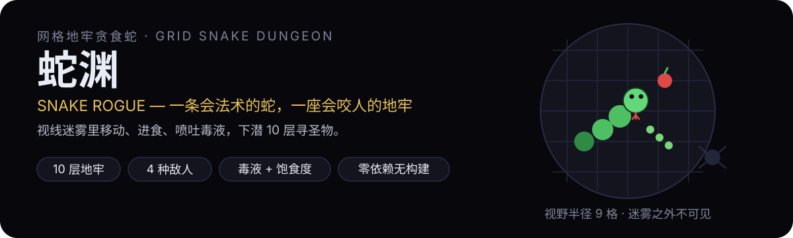
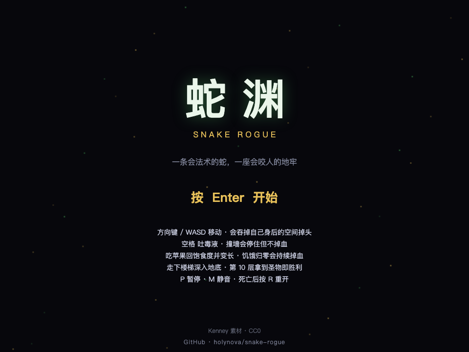
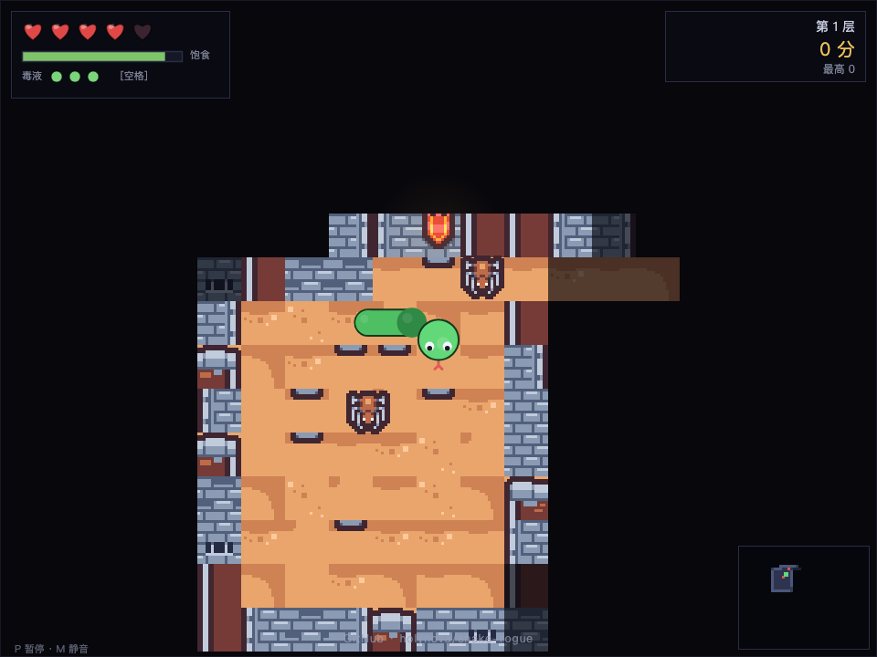

<p align="right"><a href="README.md">中文</a></p>

<p align="center">
  
</p>

<p align="center">
  <a href="https://holynova.github.io/snake-rogue/">▶ Play Online</a>
  ·
  <a href="https://github.com/holynova/snake-rogue">GitHub Repository</a>
</p>

Snake Rogue is a grid-based snake dungeon crawler with fog of war: move in real-time ticks through a 44×34 procedural dungeon, eat apples to restore hunger and grow, spit venom at enemies ahead, and descend floor by floor — grab the ancient amulet on floor 10 to win. Your own body blocks paths — and can swallow the space behind you.

## Screenshots

<p align="center">
  
  
</p>

## How to Play

- **Move**: WASD / arrow keys, one cell every 170ms; bumping into a wall stops you but costs no HP.
- **Venom**: Space spits venom ahead; 3 charges, refilled by blue potions.
- **Eat**: apples restore hunger and make you longer; at zero hunger you bleed HP continuously.
- **Descend**: take the stairs down to the next floor; pick up the ancient amulet (+500 points) on floor 10 to win.
- **Scoring**: apples 10, gold 25, chests 15, +100 per floor descended; best score saved locally.
- **Other controls**: Enter to start, P / Esc to pause, M to mute, R to restart after death.

## Enemies & Items

| Enemy | HP | Notes |
|------|------|------|
| 毒蛛 (Venom Spider) | 1 | The most common wanderer |
| 狂徒 (Berserker) | 2 | A pursuer with double HP |
| 怨灵 (Wraith) | 2 | Shortest action interval, the fastest |
| 赤甲怪 (Crimson-Armored Demon) | 4 | A heavy-armored foe dealing 2 damage |

Items: 苹果 (apples — restore hunger, grow longer), 金币 (gold coins), 红色治疗药水 (red healing potions), 蓝色毒液药水 (blue venom potions), 宝箱 (chests), 古代圣物 (the ancient amulet — the win objective).

## Run Locally

Vanilla JavaScript ES Modules + Canvas2D, zero dependencies, no build step:

```bash
npm start
# Open http://localhost:8080/
```

## Tech

- Zero dependencies: vanilla JS + Canvas2D; `server.js` is just a static file server.
- Fog of war (`src/game/fov.js`, radius 9 cells), BFS enemy pathfinding (`src/game/enemies.js`), procedural room dungeons (`src/game/dungeon.js`).
- Tiles and audio use Kenney Tiny Dungeon / RPG Audio (CC0); background music assets are kept in `assets/` — read the accompanying license files before use.

```
index.html / style.css      Entry and styles
server.js                   Static server (npm start)
src/main.js                 Entry point
src/game/constants.js       Constants: 44×34 map, 170ms tick, 10 floors, scoring
src/game/world.js           World state and win/loss checks
src/game/snake.js           Snake body, hunger, venom
src/game/enemies.js         4 enemy types + BFS pathfinding
src/game/fov.js             Fog of war
src/game/dungeon.js         Procedural dungeon generation
src/game/items.js           6 item kinds
src/engine/                 Rendering / audio / input / camera / particles / RNG
```
