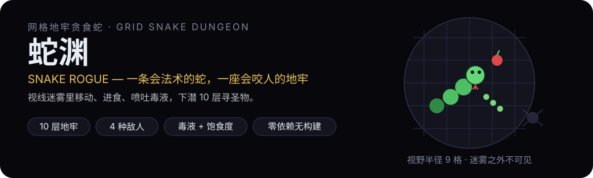
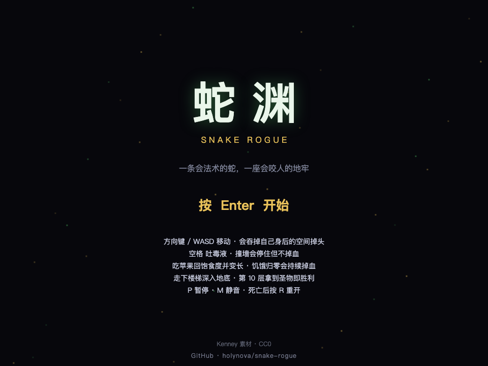
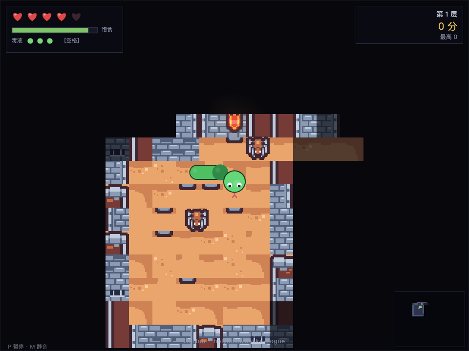

<p align="center">
  
</p>

<p align="center">
  <a href="https://holynova.github.io/snake-rogue/">▶ 在线玩 Play Online</a>
  ·
  <a href="https://github.com/holynova/snake-rogue">GitHub 仓库</a>
</p>

蛇渊是一款带视线迷雾的网格地牢贪食蛇：你在 44×34 的程序化地牢里实时逐格移动，吃苹果回饱食度并变长，用毒液处理前方敌人，走下楼梯一层层深入——第 10 层拿到古代圣物即胜利。蛇身可以卡位，但也会吞掉自己身后的空间。

Snake Rogue is a grid-based snake dungeon crawler with fog of war: move in real-time ticks through a 44×34 procedural dungeon, eat apples to restore hunger and grow, spit venom at enemies ahead, and descend floor by floor — grab the ancient amulet on floor 10 to win. Your own body blocks paths — and can swallow the space behind you.

## 截图 / Screenshots

<p align="center">
  
  
</p>

## 玩法 / How to Play

- **移动**：WASD / 方向键，每 170ms 走一格；撞墙会停住但不掉血。
- **喷毒**：Space 向前方喷吐毒液；毒液共 3 格，蓝色药水补充。
- **进食**：吃苹果回饱食度并变长；饱食度归零会持续掉血。
- **下潜**：走下楼梯深入下一层；第 10 层拿到古代圣物（+500 分）即胜利。
- **计分**：苹果 10 分、金币 25 分、宝箱 15 分、每下一层 100 分；最高分存在本地。
- **其他**：Enter 开始，P / Esc 暂停，M 静音，死亡后 R 重新开始。

## 敌人与道具 / Enemies & Items

| 敌人 | 血量 | 特点 |
|------|------|------|
| 毒蛛 | 1 | 最常见的游荡者 |
| 狂徒 | 2 | 血厚一倍的追击者 |
| 怨灵 | 2 | 行动间隔最短，速度最快 |
| 赤甲怪 | 4 | 伤害 2 点的重甲敌人 |

道具：苹果（回饱食、变长）、金币、红色治疗药水、蓝色毒液药水、宝箱、古代圣物（通关目标）。

## 本地运行 / Run Locally

原生 JavaScript ES Modules + Canvas2D，零依赖、无需打包：

```bash
npm start
# 打开 http://localhost:8080/
```

## 技术 / Tech

- 零依赖：原生 JS + Canvas2D，`server.js` 只是一个静态文件服务器。
- 视线迷雾（`src/game/fov.js`，半径 9 格）、BFS 敌人寻路（`src/game/enemies.js`）、程序化房间地牢（`src/game/dungeon.js`）。
- 图块与音效用 Kenney Tiny Dungeon / RPG Audio（CC0）；背景音乐素材保留在 `assets/`，使用前请阅读相应授权文件。

```
index.html / style.css      入口与样式
server.js                   静态服务器（npm start）
src/main.js                 入口
src/game/constants.js       常量：44×34 地图、170ms 步进、10 层、计分
src/game/world.js           世界状态与胜负判定
src/game/snake.js           蛇身、饱食度、毒液
src/game/enemies.js         4 种敌人 + BFS 寻路
src/game/fov.js             视线迷雾
src/game/dungeon.js         程序化地牢生成
src/game/items.js           6 种道具
src/engine/                 渲染 / 音频 / 输入 / 相机 / 粒子 / 随机
```

## English

**Snake Rogue** is a grid-based snake dungeon crawler with fog of war: real-time tick movement (170ms per step) through a 44×34 procedural dungeon.

- **Eat or starve**: apples restore hunger and grow your body; at zero hunger you bleed HP continuously.
- **Venom**: Space spits venom ahead (3 charges, refilled by blue potions). Your body blocks corridors — and can swallow the space behind you.
- **Goal**: descend 10 floors; pick up the ancient amulet (+500) on floor 10 to win. Apples 10, gold 25, chests 15, +100 per floor; best score saved locally.
- **Enemies**: 4 types — Spider (1 HP), Zombie (2 HP), Ghost (2 HP, fastest), Demon (4 HP, 2 damage) — with BFS pathfinding.
- **Controls**: WASD / arrows to move, Space venom, Enter start, P / Esc pause, M mute, R restart after death.
- **Run it**: `npm start`, open http://localhost:8080/. Zero dependencies, no build step — vanilla JS ES Modules + Canvas2D.
- **Tech**: fog of war (`src/game/fov.js`, radius 9), procedural room dungeons (`src/game/dungeon.js`). Tiles and audio are Kenney Tiny Dungeon / RPG Audio (CC0).
